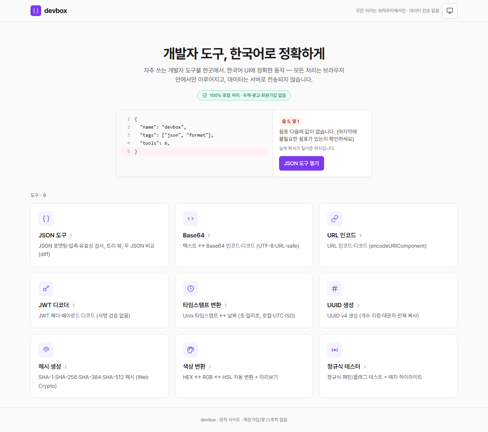

# devbox

브라우저에서만 동작하는 **한국어 개발자 도구 모음**입니다. 입력한 데이터는 밖으로 나가지 않고(외부 요청 0), 에러는 줄·열까지 한국어로 알려 줍니다.

*Browser-only Korean developer tools — zero external requests, precise Korean error messages.*

**🔗 Live:** <https://hgko1207.github.io/devbox/>



## 도구

| 분류 | 도구 |
|---|---|
| 데이터 | [JSON 도구](https://hgko1207.github.io/devbox/json) — 포맷·압축·검사·트리 뷰·두 JSON 비교. 수 MB 입력도 멈추지 않음 |
| 인코딩 | [Base64](https://hgko1207.github.io/devbox/base64) · [URL 인코드](https://hgko1207.github.io/devbox/url) · [JWT 디코더](https://hgko1207.github.io/devbox/jwt) |
| 생성·계산 | [타임스탬프 변환](https://hgko1207.github.io/devbox/timestamp) · [UUID 생성](https://hgko1207.github.io/devbox/uuid) · [해시 생성](https://hgko1207.github.io/devbox/hash) |
| 유틸리티 | [색상 변환](https://hgko1207.github.io/devbox/color) · [정규식 테스터](https://hgko1207.github.io/devbox/regex) |

어디서든 ⌘K / Ctrl+K로 도구를 바로 찾을 수 있습니다.

## 실행

```bash
npm install
npm run dev        # 개발 서버
npm test           # Vitest (55개)
npm run build      # 타입체크 + 빌드 (dist/)
npm run preview    # 빌드 결과 확인
```

React 18 · TypeScript 5 · Vite 5 · Tailwind 3 · React Router 6 · Vitest 2 · Pretendard(자체 호스팅). `main`에 푸시하면 GitHub Actions가 테스트 → 빌드 → 배포합니다.

도구별 옵션, 만든 이유, 설계 결정(한국어 에러 파서·Web Worker·품질 기준 6가지), 폴더 구조, 도구 추가 방법은 [docs/architecture.md](docs/architecture.md)에 있습니다.

## 라이선스

MIT — [LICENSE](LICENSE)
